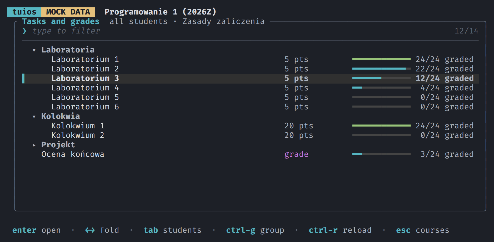
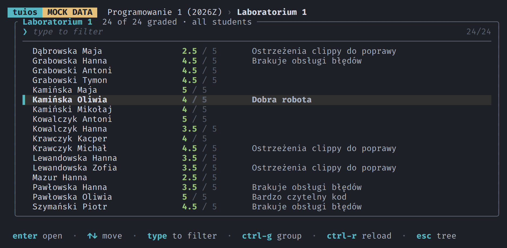
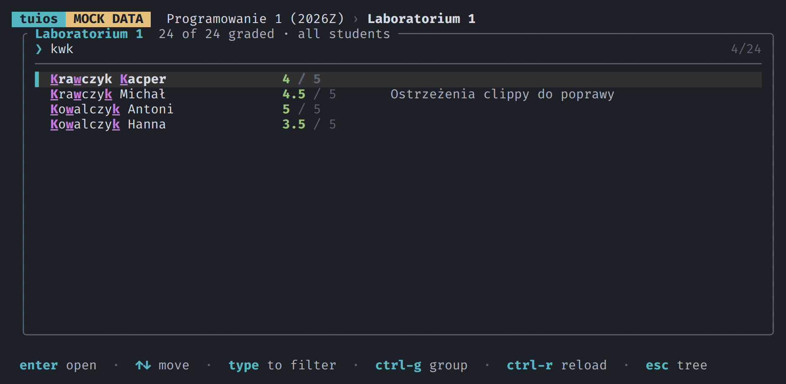
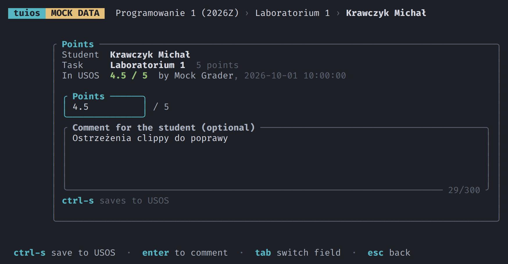
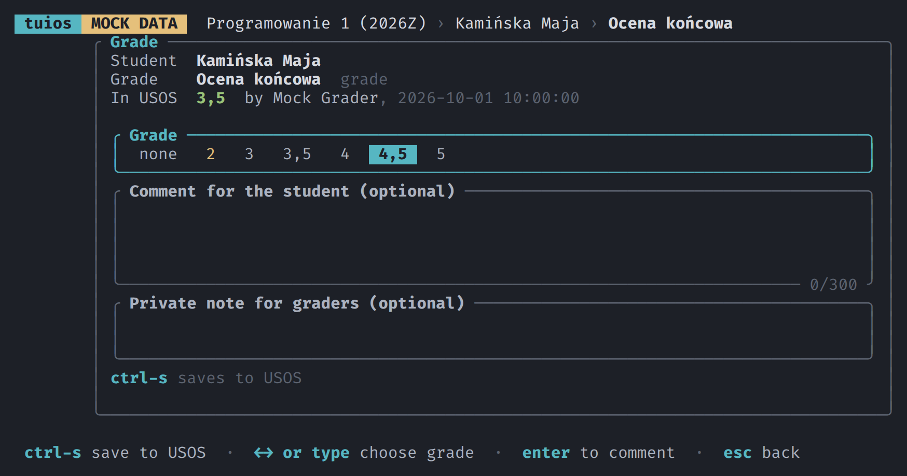
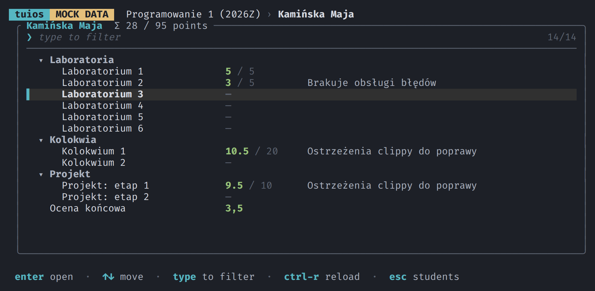
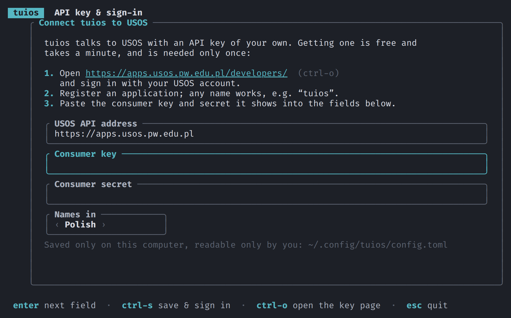

# Tuios

Tuios is a TUI interface for the USOS system, supporting fuzzy search across students, tests.
As of now it only supports view from the perspective of a teacher.
It uses the official USOS API and should work for any University that uses it and allows API access.
On start-up, you should be given instructions on how to connect.

Disclaimer: all the code here has been written by Claude. Because this is just another interface for an external service, there should be no security problems with anything.
But the code might be doing something stupid. Use at your own risk.



## Screenshots

All screenshots show `tuios --mock`: made-up students, courses and points.

| | |
|---|---|
|  |  |
| Every student's points and comment for one task | Fuzzy search everywhere |
|  |  |
| Points with a comment for the student | Grades, typed or picked with ←→ |
|  |  |
| One student's whole record | First start explains how to get an API key |

## Install

You need a Rust toolchain (<https://rustup.rs>). Then, from this directory:

```sh
cargo install --path .
tuios
```

To look around first without a USOS account, run `tuios --mock`. It never connects to
USOS: the students, courses and points are random, made up on each start, and gone
when the program exits.

## First start

The program walks you through it:

1. It asks for a USOS API key. Getting one is free: open your university's USOS API
   developer page (for Warsaw University of Technology,
   <https://apps.usos.pw.edu.pl/developers/>; Ctrl-O opens it from the program),
   sign in, and register an application under any name. Paste the consumer key and
   secret into the program.
2. It gives you a link to sign in to USOS and approve access, and asks for the PIN
   USOS shows.

Other universities running USOS work too: change the API address on the same screen.
Ctrl-K on the course list brings the screen back, e.g. to sign in again.

The key and the sign-in are stored in `~/.config/tuios/`, readable only by you.
Nothing is stored anywhere else, and this repository contains no credentials.

## Use

| Where | Keys |
|---|---|
| Everywhere | type to filter (it searches inside folded folders too), ↑↓ to move, Enter to open, Esc to clear the filter or go back |
| Course list | Ctrl-R reload, Ctrl-K API key & sign-in |
| Tree of tasks and grades | Enter or ←→ on a folder: unfold / fold, Tab: student list, Ctrl-G: show one of your groups, Ctrl-R: reload |
| Student list | Enter: all tasks and grades of that student |
| Grading form | Ctrl-S save, Tab switch field; for grades ←→ or type the grade (4 then 4 again gives 4,5) |

After a save the list moves to the next student (or task) still without a value, and
the filter clears, so grading a stack is: type a name, Enter, points, Ctrl-S, repeat.

Loading a course takes about 10 seconds: USOS answers every request for students'
points slowly, so the program asks once for the whole tree and shows its structure
in the meantime.

## Notes on the USOS API

- Saving fails with "modified in the meantime" when someone else changed the value
  since it was loaded; Ctrl-R shows the current one.
- Group filtering lists only groups you teach; USOS hides other groups' members.
